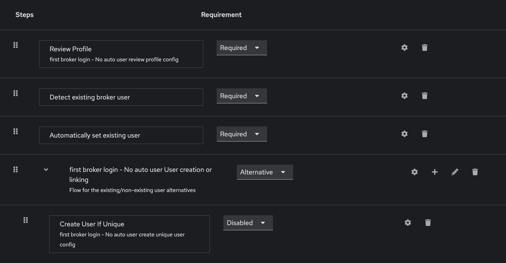

#  PeerSpace

PeerSpace is a real-time 2D spatial virtual office. Walk around as an avatar, meet people in private zones, talk over proximity video/audio, and design the office yourself with the built-in Admin Map Builder.

- [Tech stack](#tech-stack)
- [Quick start (Docker Compose)](#quick-start-docker-compose)
- [Local development without Docker](#local-development-without-docker)
- [Configuration](#configuration)
- [Audio and video](#audio-and-video)
- [Deployment](#deployment)
- [Keycloak](#keycloak)

---

## Tech stack

| Layer | Technology |
| :--- | :--- |
| Frontend | Vue 3, Tailwind CSS, Lucide icons, HTML5 Canvas |
| Backend | Hono (`@hono/node-server`), Socket.IO (presence, chat, media endpoint discovery) |
| Audio/video | [iroh](https://iroh.computer) in the browser via WebAssembly (`crates/peer-media`), WebCodecs (Opus, H.264/VP8) |
| Persistence | SQLite (`workspace.sqlite` via `bun:sqlite` / `sql.js`) |
| Auth | OpenID Connect via Keycloak |
| Tooling | Vite, esbuild, TypeScript, Vitest (runs on Bun or Node.js 18+) |

---

## Quick start (Docker Compose)

The compose setup runs everything you need:

| Service | Purpose | URL |
| :--- | :--- | :--- |
| `peerspace` | The app | http://localhost:3000 |
| `keycloak` | Login / identity provider | http://localhost:8080 |
| `keycloak-db` | Postgres database for Keycloak | internal only |
| `iroh-relay` | Relay for audio and video (see [Audio and video](#audio-and-video)) | internal, exposed through your proxy |

```bash
# 1. Set a session secret (required, see Configuration)
cp .env.example .env
echo "SESSION_SECRET=$(openssl rand -hex 32)" >> .env

# 2. Build and start everything
docker compose up -d

# 3. Check the status (Keycloak takes around a minute to become healthy)
docker compose ps
docker compose logs -f keycloak
```

On the first start Keycloak imports the `peer-space` realm from [`keycloak/import/peer-space-realm.json`](keycloak/import/peer-space-realm.json). The import sets up:

- the `peer-space` OIDC client, with its redirect URI pointing to PeerSpace
- a `groups` protocol mapper that puts group membership into the tokens
- an `admin` group

The realm starts with no users. To create one:

1. Open http://localhost:8080 and sign in with `admin` / `admin` (or your `KEYCLOAK_ADMIN_USER` / `KEYCLOAK_ADMIN_PASSWORD`).
2. Switch to the **peer-space** realm, go to **Users** → **Create new user** and set a password under **Credentials**.
3. To make the user a PeerSpace admin (map editing), add them to the **admin** group under **Groups**.
4. Open http://localhost:3000 and log in.

> [!NOTE]
> `docker-compose.override.yml` publishes ports 3000 and 8080 on the host. `docker compose` loads it automatically for local use. Platforms such as Coolify ignore it and route traffic through their own proxy.

> [!TIP]
> Keycloak is tuned for a small box: local cache, a small DB pool and a 256 MB JVM heap, capped at 512 MB (about 370 MB used idle, versus about 540 MB with Keycloak's defaults). It runs from a pre-built image (`keycloak/Dockerfile`, published to GHCR by CI) that starts in about 5 seconds instead of 13. Postgres is capped at 128 MB. With many users or sessions, raise `KEYCLOAK_MEM_LIMIT` together with the heap in `KEYCLOAK_JAVA_HEAP` (its `-Xmx`).

---

## Local development without Docker

Prerequisites: [Bun](https://bun.sh) ≥ 1.0 (or Node.js ≥ 18 with npm), plus a reachable Keycloak. The easiest option is to start only the bundled one: `docker compose up -d keycloak`.

```bash
bun install

# Dev server with watch mode on http://localhost:3000
bun run dev

# Type check & tests
bun run lint
bun run test
```

Outside Docker the server can't resolve the `keycloak` hostname. Set `KEYCLOAK_URL=http://localhost:8080/realms/peer-space` and leave `KEYCLOAK_INTERNAL_URL` unset, so it falls back to `KEYCLOAK_URL`.

---

## Configuration

All variables are documented in [`.env.example`](.env.example). The most important ones:

### PeerSpace

| Variable | Description | Default (compose) |
| :--- | :--- | :--- |
| `SESSION_SECRET` | Signs session tokens after login. **Set this.** If it's empty, a random secret is generated at boot and every restart logs everyone out. | – |
| `KEYCLOAK_URL` | Realm URL as the **browser** sees it | `http://localhost:8080/realms/peer-space` |
| `KEYCLOAK_INTERNAL_URL` | Realm URL as the **server** sees it (token exchange, userinfo). Defaults to `KEYCLOAK_URL` when unset. | `http://keycloak:8080/realms/peer-space` |
| `KEYCLOAK_CLIENT_ID` | OIDC client ID | `peer-space` |
| `KEYCLOAK_CLIENT_SECRET` | OIDC client secret. **Change this outside local dev.** | `peer-space-dev-secret` |
| `PORT` | HTTP port inside the container | `3000` |
| `DATA_DIR` | Where the SQLite database is stored | `/app/data` (volume `peerspace_data`) |
| `IROH_RELAYS` | Comma-separated `https://` URL(s) of the iroh relay as browsers see it, e.g. `https://relay.example.com`. Read at startup (restart after changing it) and served at `GET /api/media-config`. See [Audio and video](#audio-and-video). | Empty (n0's public relays) |
| `RELAY_ACCESS_TOKEN` | Shared secret that locks the iroh relay to signed-in users. Set the same value for `peerspace` and `iroh-relay` (compose does this). The app serves `/internal/relay-access` only when it is set. See [Self-hosted relay](#self-hosted-relay). | Empty (relay is open) |
| `VITE_IROH_RELAYS` | Build-time fallback for iroh relays, comma-separated `https://` URLs. Used when `IROH_RELAYS` is unset. Baked in at build time. | n0's public relays |

### Bundled Keycloak

| Variable | Description | Default |
| :--- | :--- | :--- |
| `KEYCLOAK_PUBLIC_URL` | Public base URL of Keycloak. Tokens are issued for this URL. | `http://localhost:8080` |
| `PEERSPACE_URL` | Public URL of PeerSpace (the client's redirect URI) | `http://localhost:3000` |
| `KEYCLOAK_ADMIN_USER` / `KEYCLOAK_ADMIN_PASSWORD` | Initial admin console account | `admin` / `admin` |
| `KEYCLOAK_DB_PASSWORD` | Postgres password | `keycloak` |
| `KEYCLOAK_MEM_LIMIT` / `KEYCLOAK_DB_MEM_LIMIT` | Container memory caps | `512m` / `128m` |
| `KEYCLOAK_JAVA_HEAP` | JVM heap and metaspace options for Keycloak | `-Xms64m -Xmx256m -XX:MaxMetaspaceSize=192m ...` |
| `KEYCLOAK_DB_POOL_MAX_SIZE` | Max database connections Keycloak opens | `10` |

> [!IMPORTANT]
> Keycloak reads `KEYCLOAK_CLIENT_ID`, `KEYCLOAK_CLIENT_SECRET` and `PEERSPACE_URL` only on the **first** realm import. Once the realm exists, the database holds these settings. Change them in the Keycloak admin console, or run `docker compose down -v` to wipe the database and re-import (this deletes all users).

### Bundled iroh relay

| Variable | Description | Default |
| :--- | :--- | :--- |
| `IROH_RELAY_MEM_LIMIT` | Container memory cap for the `iroh-relay` service | `128m` |
| `IROH_RELAY_ACCESS_URL` | Where the relay checks each endpoint when `RELAY_ACCESS_TOKEN` is set. Must start with `http://` or `https://`. Quotes, backslashes, spaces, brackets, `|` and `&` are not allowed. | `http://peerspace:3000/internal/relay-access` |

---

## Audio and video

Proximity audio, camera and screen share run between peers over [iroh](https://iroh.computer), compiled to WebAssembly from [`crates/peer-media`](crates/peer-media). WebRTC is not used.

- Every browser starts an iroh endpoint and announces its endpoint id over Socket.IO (`media:announce`). The announce is signed with the endpoint's key over the socket id, and every client checks it, so nobody can claim someone else's endpoint. Peers then dial each other by id. There is no offer/answer or ICE exchange, and a reconnect is just another dial. The lower endpoint id dials.
- Browsers can't open UDP sockets, so all media goes through an iroh relay. The browser uses the relay from `IROH_RELAYS` (served by the server), then the build-time `VITE_IROH_RELAYS`, then n0's public relays. The public relays are fine for trying things out. For real use, run your own relay as described in [Self-hosted relay](#self-hosted-relay).
- **Audio**: 20 ms Opus frames (32 kb/s, DTX) sent as QUIC datagrams, so a lost packet never holds up the next one. Each peer has a small jitter buffer (60 to 240 ms). Voice only goes to people in earshot who aren't deafened, and a muted mic sends nothing. Browsers without a WebCodecs Opus encoder fall back to 16 kHz mu-law.
- **Video**: the camera (640×480, 15 fps) and the screen (up to 1080p, 8 fps, tuned for text) are each encoded once and fanned out to all viewers, not once per viewer. The camera only goes to people in range. Screen shares follow zones (see [Zones and proximity](#zones-and-proximity)). Each track has its own ordered QUIC stream with a 3-frame queue. When a viewer's link can't keep up, that viewer's frames are dropped until the next keyframe instead of piling up delay. Other viewers aren't affected. Codec preference: H.264 baseline, then VP8, then VP9.
- Audio and video need WebCodecs: current Chrome, Edge, Firefox and Safari.

### Self-hosted relay

The compose file includes an `iroh-relay` service. It is built from [`relay/Dockerfile`](relay/Dockerfile) (iroh-relay 1.3.0, which must match the iroh version in [`crates/peer-media/Cargo.lock`](crates/peer-media/Cargo.lock)) and published to `ghcr.io/liquidiert/peer-space-relay` by the existing workflow. It serves plain HTTP on port 3340, configured in [`relay/relay.toml`](relay/relay.toml) (open) or [`relay/relay-locked.toml.in`](relay/relay-locked.toml.in) (access-controlled, see below). Your reverse proxy terminates TLS. QUIC/UDP and metrics are off, so only one port is used.

1. **Coolify:** give the `iroh-relay` service its own domain (e.g. `relay.example.com`) on port 3340. The compose file has `SERVICE_FQDN_IROHRELAY_3340` for this.
2. **Dokploy:** add a domain for the `iroh-relay` service, port 3340, in the UI.
3. The proxy must serve that domain over HTTPS and allow WebSocket upgrades (Traefik does by default).
4. Set `IROH_RELAYS=https://relay.example.com` on `peerspace` and redeploy.
5. Check it: `https://relay.example.com/healthz` should return `{"status":"ok",...}`.

- Media stays end-to-end encrypted. The relay only forwards packets it can't read.
- Browsers can't make direct peer-to-peer connections (no UDP), so all media passes through the relay. Bandwidth is the main cost. Each sender→viewer stream is up to about 450 kbit/s for a camera and 1.2 Mbit/s for a screen share, in and out of the relay. For example, 8 people with cameras in one zone come to about 25 Mbit/s in and 25 Mbit/s out. CPU and RAM use is small.
- The relay is open by default: anyone who knows the URL can relay through it. To lock it, set one shared secret, `RELAY_ACCESS_TOKEN`, in the environment. Compose passes it to both `peerspace` and `iroh-relay`. Generate it with `openssl rand -hex 32`:

  ```env
  RELAY_ACCESS_TOKEN=<openssl rand -hex 32>
  ```

- With `RELAY_ACCESS_TOKEN` set, the relay admits only endpoints of users who are currently signed in to PeerSpace. When it is unset, the relay is open. Restart the stack after changing it.
- The check runs when a connection is made. A user who leaves keeps an open relay connection until it drops.

### Zones and proximity

- Entering a private zone takes effect after you have stayed in it for 1 second. Walking through doesn't connect you to the zone, and you stay connected to nearby people on the floor in the meantime. Leaving a zone takes effect immediately.
- Screen shares stay in their zone. A share from inside a zone goes only to people settled in that zone. A share on the open floor goes to everyone on the floor, at any distance.
- Click-to-walk routes avoid passing through private zones (including desk zones) when a reasonable detour exists.

### Rebuilding the wasm module

`src/wasm/` is generated, so don't edit it by hand. After changing `crates/peer-media`, rebuild it and commit the output:

```bash
rustup target add wasm32-unknown-unknown
cargo install wasm-bindgen-cli --version 0.2.128   # must match Cargo.toml
./scripts/build-wasm.sh                            # also needs clang; uses wasm-opt if installed
```

---

## Deployment

### Docker Compose (e.g. Coolify)

`docker-compose.yml` is ready for production. Put a TLS-terminating reverse proxy in front of `peerspace`, `keycloak` and `iroh-relay` (see [Self-hosted relay](#self-hosted-relay)), then set at least:

```env
SESSION_SECRET=<openssl rand -hex 32>
PEERSPACE_URL=https://peerspace.example.com
IROH_RELAYS=https://relay.example.com
KEYCLOAK_PUBLIC_URL=https://auth.example.com
KEYCLOAK_URL=https://auth.example.com/realms/peer-space
KEYCLOAK_CLIENT_SECRET=<openssl rand -hex 32>
KEYCLOAK_ADMIN_PASSWORD=<strong password>
KEYCLOAK_DB_PASSWORD=<strong password>
```

Keycloak trusts `X-Forwarded-*` headers (`KC_PROXY_HEADERS=xforwarded`), so make sure your proxy sets them.

### Using an external Keycloak

To use an existing Keycloak instead of the bundled one, remove the `keycloak` and `keycloak-db` services. Then point both URLs at your realm:

```env
KEYCLOAK_URL=https://cloak.example.com/realms/<realm>
KEYCLOAK_INTERNAL_URL=https://cloak.example.com/realms/<realm>
KEYCLOAK_CLIENT_ID=<client>
KEYCLOAK_CLIENT_SECRET=<secret>
```

Configure the client as described in [Admin permissions](#admin-permissions).

### Plain Docker

```bash
docker build -t peerspace .
docker run -d --name peerspace -p 3000:3000 \
  -v peerspace_data:/app/data -e DATA_DIR=/app/data \
  -e SESSION_SECRET="$(openssl rand -hex 32)" \
  -e KEYCLOAK_URL="https://cloak.example.com/realms/peer-space" \
  -e KEYCLOAK_CLIENT_ID="peer-space" \
  -e KEYCLOAK_CLIENT_SECRET="<secret>" \
  peerspace
```

### Without Docker

```bash
bun run build   # Vite client build to dist/, esbuild server bundle to dist/server.js
bun dist/server.js
```

### Health check

```bash
curl http://localhost:3000/api/health
# {"status":"ok","activeUsers":0}
```

---

## Keycloak

### Admin permissions

PeerSpace scans the OIDC userinfo and token payloads for an `admin` or `/admin` entry in `groups`, `roles`, `realm_access`, `resource_access` or custom claims. Users with that entry get admin rights, including map editing.

The bundled realm already has this configured. For an external Keycloak, add a group mapper to your client:

1. **Clients** → your client → **Client scopes** → the dedicated scope → **Add mapper** → **By configuration** → **Group Membership**
2. Set **Name** / **Token Claim Name** to `groups`, turn **Full group path** on, and turn **Add to ID token**, **Add to access token** and **Add to userinfo** on.
3. Create an `admin` group and add your admins to it.

Without the mapper, `groups` contains only Keycloak's default roles (`default-roles-*`, `offline_access`, `uma_authorization`), and no one becomes an admin.

### Identity provider brokering (first broker login)

When users log in through an external identity provider (Google Workspace, another OIDC broker, …), you may want to stop Keycloak from creating accounts automatically. To do that, use a **First Broker Login – No Auto User** flow under **Authentication**:



| Step | Execution | Requirement |
| :--- | :--- | :--- |
| 1 | **Review Profile** (`first broker login - No auto user review profile config`) | `Required` |
| 2 | **Detect existing broker user** | `Required` |
| 3 | **Automatically set existing user** | `Required` |
| 4 | **first broker login - No auto user User creation or linking** | `Alternative` |
| 5 | **Create User If Unique** (`first broker login - No auto user create unique user config`) | `Disabled` |
